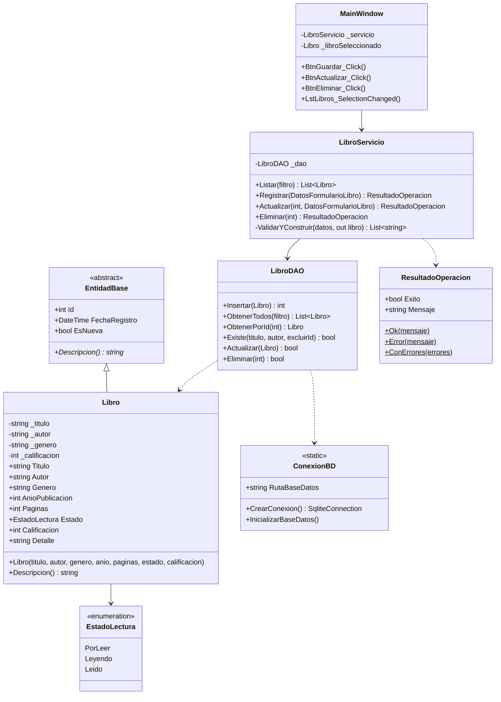

# Biblioteca Personal

Aplicación de escritorio en **C# / .NET 8** con **Avalonia UI** y **ADO.NET + SQLite** para administrar una colección personal de libros.

> Parcial final: Programación con C# y .NET

---

## 1. Información general

| | |
|---|---|
| **Proyecto** | Biblioteca Personal |
| **Estudiante** | Álvaro Cuevas |
| **Asignatura** | Programación con C# y .NET |
| **Tipo** | Aplicación de escritorio (Avalonia UI) |

**Descripción.** Biblioteca Personal permite registrar los libros que una persona tiene o quiere leer: título, autor, género, año de publicación, número de páginas, estado de lectura (*Por leer*, *Leyendo*, *Leído*) y una calificación de 1 a 5 estrellas. Los datos quedan guardados en una base de datos SQLite local.

**Problema que resuelve.** Quien lee con frecuencia suele perder la cuenta de qué libros tiene pendientes, cuáles está leyendo y qué le parecieron los que terminó. Las notas sueltas o las hojas de cálculo se desordenan fácilmente. La aplicación reúne esa información en un solo lugar, con búsqueda y validaciones.

**Objetivo principal.** Ofrecer una herramienta sencilla para registrar, consultar, modificar y eliminar libros de una colección personal, con datos que se conservan entre ejecuciones.

---

## 2. Funcionalidades

| Operación | Cómo se hace en la aplicación |
|---|---|
| **Registrar (Create)** | Llenar el formulario de la izquierda y pulsar **Guardar**. |
| **Consultar (Read)** | La lista de la derecha muestra todos los libros ordenados por título. El cuadro **Buscar** filtra por título, autor o género (botón *Buscar* o tecla Enter); **Mostrar todos** quita el filtro. |
| **Modificar (Update)** | Seleccionar un libro en la lista; sus datos pasan al formulario. Cambiarlos y pulsar **Actualizar**. |
| **Eliminar (Delete)** | Seleccionar un libro y pulsar **Eliminar**. Se pide confirmación en una ventana modal. |
| **Limpiar / Nuevo** | Vacía el formulario y quita la selección para registrar un libro nuevo. |

**Validaciones** (los errores se muestran en un aviso rojo, sin cerrar el programa):

- Título y autor obligatorios; límites de longitud (150 / 100 / 50 caracteres).
- El autor no puede contener números.
- Año de publicación numérico, entre 1000 y el año actual.
- Páginas numéricas, entre 1 y 20 000.
- **Regla de negocio:** solo se pueden calificar libros en estado *Leído*.
- No se permite registrar dos veces el mismo libro (mismo título y autor).

Cada operación exitosa muestra un aviso verde con el resultado. El pie de la ventana muestra la ruta del archivo de base de datos.

---

## 3. Tecnologías utilizadas

| Tecnología | Versión / detalle |
|---|---|
| .NET SDK | 8.0 (`net8.0`) |
| Lenguaje | C# 12 |
| Interfaz gráfica | Avalonia UI 11.2.3 (`Avalonia`, `Avalonia.Desktop`, `Avalonia.Themes.Fluent`, `Avalonia.Fonts.Inter`) |
| Acceso a datos | ADO.NET con `Microsoft.Data.Sqlite` 8.0.11 |
| Base de datos | SQLite 3 (el motor viene incluido en el paquete, no hay que instalarlo) |
| Control de versiones | Git y GitHub |

No se usa Entity Framework ni ningún ORM: todo el SQL está escrito a mano en `Data/LibroDAO.cs`.

---

## 4. Estructura del proyecto

```
BibliotecaPersonal/
├── BibliotecaPersonal.csproj      # Proyecto .NET y paquetes NuGet
├── Program.cs                     # Punto de entrada (inicia Avalonia)
├── App.axaml / App.axaml.cs       # Aplicación: tema y arranque (inicializa la BD)
│
├── Models/                        # Clases que representan los datos
│   ├── EntidadBase.cs             # Clase abstracta: Id, FechaRegistro, Descripcion()
│   ├── Libro.cs                   # Entidad principal (hereda de EntidadBase)
│   └── EstadoLectura.cs           # Enum: PorLeer, Leyendo, Leido
│
├── Data/                          # Acceso a datos con ADO.NET
│   ├── ConexionBD.cs              # Cadena de conexión, creación de la BD y la tabla
│   └── LibroDAO.cs                # Operaciones CRUD con SQL parametrizado
│
├── Services/                      # Lógica del programa
│   ├── LibroServicio.cs           # Validaciones y reglas de negocio; llama al DAO
│   ├── DatosFormularioLibro.cs    # Datos crudos del formulario (record)
│   └── ResultadoOperacion.cs      # Resultado (éxito/error + mensaje) para la interfaz
│
├── Views/                         # Interfaz gráfica (XAML + code-behind)
│   ├── MainWindow.axaml(.cs)      # Ventana principal: formulario, lista y eventos
│   └── DialogoConfirmacion.axaml(.cs)  # Ventana modal para confirmar eliminación
│
├── Database/
│   └── esquema.sql                # Script de la tabla (referencia; la app lo ejecuta sola)
│
├── evidencias/                    # Capturas de las pruebas funcionales
└── README.md
```

### Capas y responsabilidades

La aplicación está separada en tres capas. Cada una solo conoce a la siguiente:

```
MainWindow (interfaz)  ──►  LibroServicio (lógica)  ──►  LibroDAO (datos)  ──►  SQLite
        ▲                          │
        └──── ResultadoOperacion ──┘
```

| Clase | Responsabilidad |
|---|---|
| `MainWindow` | Recoge lo que el usuario escribe, responde a los eventos (`Click`, `SelectionChanged`, `KeyDown`) y muestra los resultados. No contiene SQL ni validaciones. |
| `LibroServicio` | Valida los datos del formulario, convierte texto a números, aplica las reglas de negocio (duplicados, calificación solo para leídos), captura los errores de SQLite y devuelve un `ResultadoOperacion`. |
| `LibroDAO` | Única clase que ejecuta SQL. Implementa `Insertar`, `ObtenerTodos`, `ObtenerPorId`, `Existe`, `Actualizar` y `Eliminar`. |
| `ConexionBD` | Define dónde vive el archivo `.db`, crea conexiones y la tabla inicial. |
| `Libro` | Representa un libro con sus propiedades y propiedades calculadas para mostrar (`Detalle`, `Estrellas`, `EstadoDescripcion`). |
| `EntidadBase` | Datos comunes de toda entidad persistida. |

### Diagrama de clases (UML)



### Dónde se aplica la POO

| Concepto | Dónde | Para qué |
|---|---|---|
| **Clases y objetos** | `Libro`, `LibroDAO`, `LibroServicio`, `MainWindow`… | Cada elemento del sistema es una clase con una sola responsabilidad. |
| **Constructores** | `Libro(...)`, `LibroServicio(LibroDAO dao)`, `DialogoConfirmacion(string mensaje)` | `LibroServicio` recibe el DAO por constructor, lo que permite cambiarlo (por ejemplo, para pruebas). |
| **Encapsulamiento** | `Libro`: campos privados `_titulo`, `_calificacion`… expuestos por propiedades que limpian espacios o rechazan valores fuera de rango. `EntidadBase.Id` tiene `internal set`: la interfaz no puede cambiar el Id. `_dao` es `private readonly`. | El objeto nunca queda en un estado inválido y solo las capas internas manipulan el Id. |
| **Herencia** | `Libro : EntidadBase` | Id y FechaRegistro son comunes a cualquier entidad persistida. Si se agrega otra entidad (Autor, Préstamo) la reutiliza. |
| **Abstracción** | `EntidadBase` es `abstract` con el método abstracto `Descripcion()` | No tiene sentido crear una "entidad" genérica; cada entidad concreta define cómo se describe. |
| **Polimorfismo** | `Libro` sobrescribe `Descripcion()` y `ToString()` | Los mensajes del servicio usan `libro.Descripcion()` sin saber el detalle de la clase. |
| **Enumeraciones** | `EstadoLectura` | Limita el estado a valores válidos en vez de usar textos libres. |

---

## 5. Instalación de dependencias

### Requisitos

- **SDK de .NET 8.0** (o superior). Descargar en <https://dotnet.microsoft.com/download/dotnet/8.0>.
  Comprobar la instalación con:
  ```bash
  dotnet --version
  ```
  Debe mostrar `8.0.x` o una versión mayor.
- **Git**, para clonar el repositorio.
- Sistema operativo: Windows 10/11, Linux o macOS.

No hace falta instalar SQLite ni ninguna herramienta adicional: `Microsoft.Data.Sqlite` incluye el motor nativo.

### Paquetes NuGet del proyecto

Declarados en `BibliotecaPersonal.csproj`; se descargan solos con `dotnet restore`:

| Paquete | Versión |
|---|---|
| Avalonia | 11.2.3 |
| Avalonia.Desktop | 11.2.3 |
| Avalonia.Themes.Fluent | 11.2.3 |
| Avalonia.Fonts.Inter | 11.2.3 |
| Microsoft.Data.Sqlite | 8.0.11 |

### Obtener el código y restaurar

```bash
git clone https://github.com/<usuario>/BibliotecaPersonal.git
cd BibliotecaPersonal
dotnet restore
```

No se requiere ninguna configuración adicional.

---

## 6. Ejecución del programa

Desde la carpeta raíz del repositorio (donde está `BibliotecaPersonal.csproj`):

```bash
dotnet restore
dotnet run
```

`dotnet run` compila y abre la ventana. Para solo compilar: `dotnet build`.

---

## 7. Base de datos

**Qué almacena.** Los libros de la biblioteca, en una sola tabla.

**Tabla `Libros`**

| Campo | Tipo | Restricciones | Descripción |
|---|---|---|---|
| `Id` | INTEGER | PRIMARY KEY AUTOINCREMENT | Identificador |
| `Titulo` | TEXT | NOT NULL | Título del libro |
| `Autor` | TEXT | NOT NULL | Autor |
| `Genero` | TEXT | NOT NULL DEFAULT '' | Género (opcional) |
| `AnioPublicacion` | INTEGER | NOT NULL | Año de publicación |
| `Paginas` | INTEGER | NOT NULL, CHECK > 0 | Número de páginas |
| `Estado` | TEXT | NOT NULL, CHECK IN ('PorLeer','Leyendo','Leido') | Estado de lectura |
| `Calificacion` | INTEGER | NOT NULL DEFAULT 0, CHECK 0–5 | Estrellas (0 = sin calificar) |
| `FechaRegistro` | TEXT | NOT NULL | Fecha de registro (`yyyy-MM-dd HH:mm:ss`) |

**Conexión con SQLite.** `Data/ConexionBD.cs` arma la cadena de conexión con `SqliteConnectionStringBuilder` (modo `ReadWriteCreate`) y expone `CrearConexion()`, que devuelve un `SqliteConnection` nuevo. Cada método del DAO abre su propia conexión dentro de un bloque `using`, de modo que la conexión, el comando y el lector se cierran siempre, aunque ocurra una excepción.

**Ubicación del archivo.** La base se guarda en la carpeta de datos del usuario, no en `bin/`, para que no se pierda al recompilar:

| Sistema | Ruta |
|---|---|
| Windows | `%LOCALAPPDATA%\BibliotecaPersonal\biblioteca.db` |
| Linux | `~/.local/share/BibliotecaPersonal/biblioteca.db` |
| macOS | `~/Library/Application Support/BibliotecaPersonal/biblioteca.db` |

La ruta exacta también aparece en el pie de la ventana.

**Dónde se hace el CRUD.** En `Data/LibroDAO.cs`:

| Operación | Método | SQL |
|---|---|---|
| Create | `Insertar` | `INSERT INTO Libros ... ; SELECT last_insert_rowid();` |
| Read | `ObtenerTodos`, `ObtenerPorId`, `Existe` | `SELECT ... WHERE ... LIKE @filtro` |
| Update | `Actualizar` | `UPDATE Libros SET ... WHERE Id = @id` |
| Delete | `Eliminar` | `DELETE FROM Libros WHERE Id = @id` |

Todos los datos del usuario entran como **parámetros** (`@titulo`, `@autor`, `@id`, …) con `Parameters.AddWithValue`, nunca concatenados en el texto SQL. Esto evita la inyección SQL y problemas con comillas (por ejemplo, un título como *L'Étranger*).

**Inicialización.** Es **automática**. Al iniciar, `App.OnFrameworkInitializationCompleted` llama a `ConexionBD.InicializarBaseDatos()`, que crea el archivo (si no existe) y ejecuta `CREATE TABLE IF NOT EXISTS Libros (...)`. No hay que ejecutar ningún procedimiento manual. El archivo `Database/esquema.sql` contiene el mismo script como referencia y unos datos de ejemplo opcionales.

---

## 8. Problemas encontrados y soluciones

**1. Avalonia no tiene un `MessageBox` integrado.**
Para confirmar la eliminación se necesitaba una ventana de "¿Está seguro?", pero Avalonia (a diferencia de WinForms o WPF) no trae `MessageBox.Show`.
*Solución:* se creó `Views/DialogoConfirmacion.axaml`, una ventana pequeña que se abre con `ShowDialog<bool>(this)` y devuelve `true` o `false` con `Close(true/false)`. Por eso el manejador `BtnEliminar_Click` es `async`: espera la respuesta antes de borrar. Los demás mensajes se muestran en un recuadro dentro de la ventana principal, en verde o rojo.

**2. La base de datos "desaparecía" al recompilar.**
Al principio el archivo `.db` se creaba junto al ejecutable, dentro de `bin/Debug/net8.0/`. Al limpiar el proyecto o cambiar de configuración (Debug/Release) se perdían los datos, lo que rompía la prueba de persistencia.
*Solución:* `ConexionBD` guarda el archivo en `Environment.SpecialFolder.LocalApplicationData`, una carpeta del usuario que no depende de la compilación. La ruta se muestra en la interfaz para poder verificarla.

**3. Parámetros nulos en SQL.**
La búsqueda debía funcionar con y sin filtro usando una sola consulta (`WHERE @filtro IS NULL OR Titulo LIKE @filtro ...`). Pasar `null` de C# a `AddWithValue` no funciona: ADO.NET exige `DBNull.Value`.
*Solución:* cuando el filtro está vacío se pasa `DBNull.Value`; si no, se pasa `"%texto%"`. Lo mismo en `Existe`, con `(object?)excluirId ?? DBNull.Value`.

**4. Validación de números escritos como texto.**
Los `TextBox` devuelven texto; convertir con `int.Parse` lanzaba una excepción y cerraba el programa cuando el usuario escribía letras.
*Solución:* la conversión se hace con `int.TryParse` dentro de `LibroServicio`, que acumula todos los errores en una lista y los devuelve en un `ResultadoOperacion`. La interfaz solo muestra el mensaje y la aplicación nunca se cierra por un dato mal escrito.
